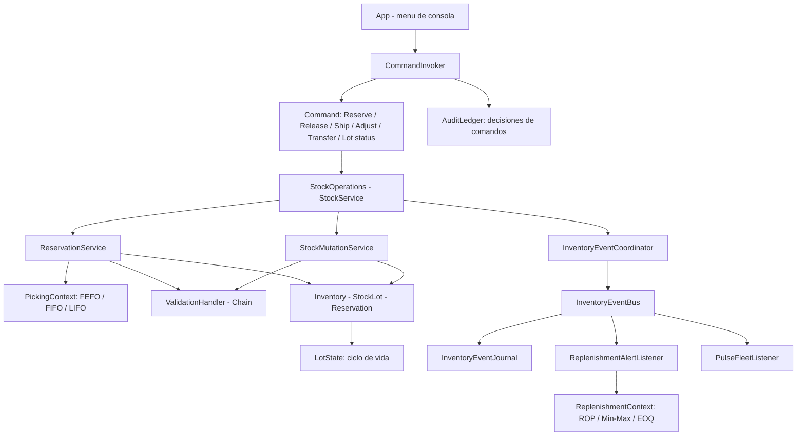
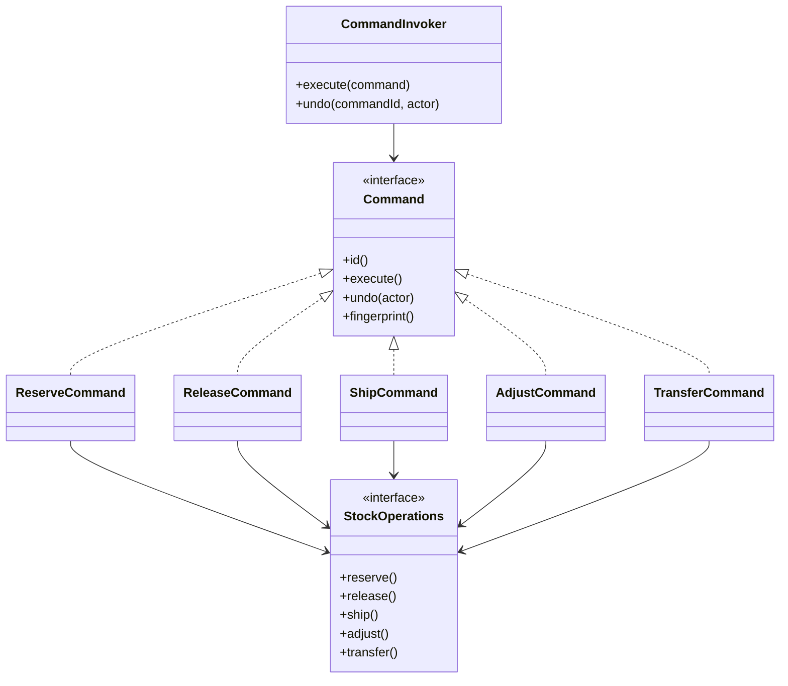
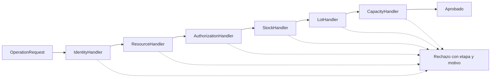
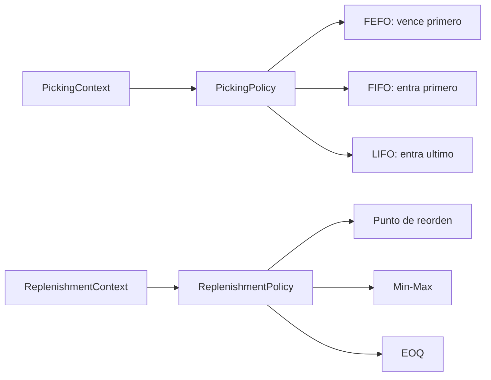
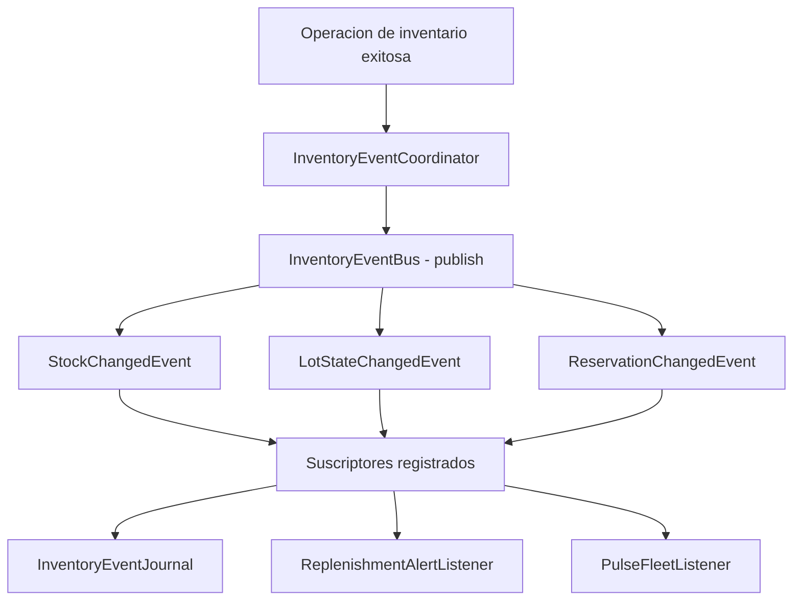

# LOGISTPULSE · Smart Inventory

**Sistema inteligente de inventario y gestión de reservas de stock, desarrollado en Java 17.**  
Prototipo académico con arquitectura por responsabilidades y cinco patrones de comportamiento: **Command, Chain of Responsibility, Strategy, State y Observer**.

> LOGISTPULSE administra productos, bodegas, lotes, reservas y movimientos. Selecciona lotes de forma inteligente, verifica condiciones de seguridad y capacidad, registra operaciones, controla el ciclo de vida de cada lote y comunica los cambios a componentes interesados.

## Índice

1. [Objetivo y funcionalidades](#objetivo-y-funcionalidades)
2. [Arquitectura del sistema](#arquitectura-del-sistema)
3. [Estructura del proyecto](#estructura-del-proyecto)
4. [Patrones de diseño](#patrones-de-diseño)
5. [Reglas de negocio](#reglas-de-negocio)
6. [Ejecución en GitHub Codespaces](#ejecución-en-github-codespaces)
7. [Demostración guiada](#demostración-guiada)
8. [Pruebas y límites](#pruebas-y-límites)

## Objetivo y funcionalidades

El sistema permite controlar el stock de una empresa que gestiona productos con **SKU**, **fecha de ingreso**, **fecha de caducidad**, **bodega de almacenamiento** y **restricciones de calidad**. La aplicación expone un menú por consola y mantiene los datos en memoria durante la sesión.

| Área | Funcionalidad |
|---|---|
| Inventario | Consultar productos, bodegas, lotes, existencias y cantidad reservada |
| Reserva | Reservar un lote específico o repartir una solicitud entre varios lotes |
| Preparación | Controlar capacidad de *staging* (espacio para pedidos preparados) |
| Despacho | Despachar una reserva, descontar stock físico y cerrar la reserva |
| Operaciones | Liberar, ajustar y transferir unidades entre bodegas |
| Calidad | Bloquear lotes en cuarentena y permitir su reincorporación controlada |
| Ciclo de vida | Identificar lotes RECEIVED, STORED, RESERVED, SHIPPED y QUARANTINED |
| Inteligencia | Aplicar FEFO, FIFO, LIFO y calcular recomendaciones ROP, Min-Max y EOQ |
| Trazabilidad | Numerar comandos, reservas y nuevos lotes; mantener auditoría y eventos |
| Integraciones simuladas | Alertas de reposición y avisos a PULSEFLEET mediante Observer |

### Identificación de los objetos

| Tipo | Ejemplo | Significado |
|---|---|---|
| Comando | `CMD-000001` | Solicitud identificada para ejecución, idempotencia y auditoría |
| Reserva | `RES-000001` | Pedido reservado con una o más asignaciones a lotes |
| Lote | `LOT-200` | Partida física de un producto en una bodega |
| Lote transferido | `LOT-T-000001` | Partida creada en la bodega de destino |
| SKU | `MED-002` | Código único de producto |
| Bodega | `WH-01` | Ubicación con capacidad de almacenamiento y preparación |

## Arquitectura del sistema

El **invocador** ejecuta comandos. El **receptor** coordina el servicio específico, que aplica políticas de selección y una cadena ordenada de validaciones. Después de una mutación exitosa, se publican eventos inmutables para los observadores suscritos.



La consola no implementa reglas de negocio. `SampleData` conecta servicios, políticas, validadores y suscriptores por inyección de dependencias; los comandos dependen de la interfaz `StockOperations` y no de una clase concreta.

## Estructura del proyecto

```text
logistpulse-smart-inventory-java/
├── .github/workflows/ci.yml       # Integracion continua con Java + JUnit
├── src/
│   ├── main/java/ec/edu/logistpulse/
│   │   ├── App.java                 # Interfaz de consola
│   │   ├── bootstrap/               # Composicion e inyeccion de dependencias
│   │   ├── command/                 # Command e invocador
│   │   ├── chain/                   # Chain of Responsibility
│   │   ├── strategy/
│   │   │   ├── picking/             # FEFO, FIFO, LIFO
│   │   │   └── replenishment/       # ROP, Min-Max, EOQ
│   │   ├── state/                   # Estados del lote y transiciones
│   │   ├── observer/                # Eventos, bus y suscriptores
│   │   ├── domain/                  # Inventory, Product, StockLot, Reservation
│   │   ├── service/                 # Operaciones de negocio y coordinacion
│   │   ├── security/                # Roles de demostracion
│   │   └── audit/                   # Historial de decisiones de Command
│   ├── test/java/ec/edu/logistpulse/ # Pruebas JUnit 5
│   └── smoke/                       # Verificaciones funcionales sin Maven
├── scripts/smoke.sh
├── docs/                            # Documentacion adicional
├── pom.xml                          # Maven / Java 17
└── README.md
```

## Patrones de diseño

### 1. Command — Operaciones como objetos

**Propósito.** Encapsular una operación en un objeto independiente de la consola que la solicita. Cada comando tiene `id()`, `execute()`, `undo()`, tipo, actor, objeto objetivo y una huella de la solicitud.



**Aplicación.** `ReserveCommand` guarda la solicitud y delega al receptor; `ReleaseCommand`, `AdjustCommand` y `TransferCommand` poseen compensaciones condicionadas. `ShipCommand` **no se deshace automáticamente**: recuperar un envío físico exige otro proceso de devolución. También existen `StoreLotCommand`, `QuarantineLotCommand` y `ReinstateLotCommand` para el estado de los lotes. La operación de put-away es reversible solo mientras ninguna acción posterior haya modificado el lote.

**Idempotencia.** `CommandInvoker` compara `commandId` y huella del contenido. Repetir exactamente el mismo comando devuelve el resultado registrado, sin ejecutar la operación por segunda vez. Reutilizar el ID con otros datos genera un rechazo `IDEMPOTENCY`.

### 2. Chain of Responsibility — Validaciones secuenciales

**Propósito.** Cada eslabón comprueba una regla, puede rechazar la solicitud con una razón o pasarla al siguiente; no manipula inventario.



**Aplicación.** La misma cadena valida reservas, liberaciones, despachos, ajustes, transferencias y controles de lote. Por ejemplo, una reserva no avanza si el actor no existe, el SKU no está registrado, faltan unidades o no hay capacidad de preparación. El resultado identifica la etapa que rechazó la operación.

### 3. Strategy — Algoritmos intercambiables

**Propósito.** Sustituir una política durante la ejecución sin cambiar la implementación del servicio ni de la cadena de validación.



**Picking.** Al ingresar `AUTO`, `PickingContext` ordena los lotes elegibles por la política activa y construye un plan de reparto. El plan puede dividir una reserva entre lotes del mismo SKU y bodega. Después, **Chain valida el plan**. FEFO, FIFO y LIFO solo deciden el orden; no autorizan permisos ni alteran el stock.

**Reposición.** `ReplenishmentContext` recomienda cantidades mediante punto de reorden, Min-Max o cantidad económica de pedido (EOQ). Es un cálculo orientativo: no genera órdenes de compra automáticamente.

### 4. State — Ciclo de vida de los lotes

**Propósito.** El comportamiento de un lote depende de su estado actual. `StockLot` conserva un objeto `LotState` y delega en él las transiciones; los estados son clases concretas, no simples nombres guardados en una cadena.

```mermaid
stateDiagram-v2
  [*] --> RECEIVED: recepción nueva
  RECEIVED --> STORED: put-away autorizado
  STORED --> RECEIVED: undo put-away si no fue usado
  RECEIVED --> QUARANTINED: control de calidad
  STORED --> RESERVED: reservar unidades
  RESERVED --> RESERVED: reservas adicionales
  RESERVED --> STORED: liberar todo lo reservado
  RESERVED --> STORED: despachar; queda stock disponible
  RESERVED --> SHIPPED: despachar; lote agotado
  STORED --> QUARANTINED: inmovilizar sin reservas
  QUARANTINED --> STORED: liberación de calidad
  SHIPPED --> [*]
```



**Semántica importante:** un lote con unidades reservadas está en `RESERVED` aunque conserve otras unidades disponibles. Después de despachar una reserva, puede volver a `STORED` si aún tiene stock; solo pasa a `SHIPPED` cuando se despachan todas sus unidades y queda agotado. `QUARANTINED` bloquea nuevas reservas. La caducidad se comprueba por separado y nunca se anula al salir de cuarentena.

Clases: `LotState`, `ReceivedState`, `StoredState`, `ReservedState`, `ShippedState`, `QuarantinedState`. La reserva posee su propio estado (`ACTIVE`, `RELEASED` o `SHIPPED`), independiente del estado del lote.

### 5. Observer — Eventos de inventario y suscriptores

**Propósito.** Comunicar cambios sin obligar a que el inventario conozca a cada consumidor. La publicación ocurre **después de una operación exitosa** y transporta datos inmutables.



Los suscriptores reaccionan así:

- **InventoryEventJournal:** conserva la secuencia de hechos emitidos (un ledger de eventos separado de la auditoría de comandos).
- **ReplenishmentAlertListener:** revisa existencias y genera alertas orientativas cuando la política de reposición recomienda unidades.
- **PulseFleetListener:** simula la creación de tareas de picking y el registro de despachos. **No existe una conexión real con robots**.

Se utiliza una entrega **síncrona en memoria**. Los errores de un suscriptor se registran y no cambian el resultado de una operación ya confirmada. Los comandos rechazados y los reintentos idénticos no publican eventos de stock ficticios.

## Reglas de negocio

- **Reserva:** stock elegible no vencido, no en cuarentena, SKU y bodega coincidentes, sin superar capacidad de preparación; una cantidad puede repartirse en múltiples lotes.
- **Liberación:** solo el propietario de la reserva o un supervisor puede liberar sus unidades. Las cantidades vuelven a estar disponibles.
- **Despacho:** solo el propietario o supervisor despacha una reserva activa; se reducen tanto las unidades físicas como las reservadas y se libera espacio de preparación.
- **Ajuste y transferencia:** requieren supervisor. No pueden retirar unidades ya reservadas ni sobrepasar la capacidad de almacenamiento.
- **Calidad:** solo un supervisor puede inmovilizar, reincorporar o guardar un lote recibido. No se permite poner en cuarentena un lote con reservas activas.
- **Comandos:** el historial de ejecuciones conserva identificadores, actor, tipo, objeto objetivo, éxito/rechazo y sello de tiempo.

## Ejecución en GitHub Codespaces

El repositorio usa **Java 17**, **Maven** y **JUnit 5**. Puedes abrirlo desde GitHub mediante **Code → Codespaces → Create codespace on main**, sin instalar estas herramientas en tu computador.

**1. Ejecutar pruebas:**

```bash
mvn clean test
```

**2. Compilar:**

```bash
mvn -q -DskipTests package
```

**3. Abrir el menú:**

```bash
java -cp target/classes ec.edu.logistpulse.App
```

**Verificación rápida alternativa (solo JDK):**

```bash
bash scripts/smoke.sh
```

### Menú interactivo

| Opción | Función | Opción | Función |
|---:|---|---:|---|
| 1 | Ver inventario y estados | 9 | Seleccionar política de reposición |
| 2 | Reservar stock | 10 | Calcular recomendación |
| 3 | Liberar reserva | 11 | Deshacer comando cuando sea seguro |
| 4 | Ajustar existencias | 12 | Despachar reserva |
| 5 | Transferir entre bodegas | 13 | Poner lote en cuarentena |
| 6 | Consultar reservas | 14 | Reincorporar lote |
| 7 | Consultar auditoría Command | 15 | Almacenar lote recibido |
| 8 | Cambiar FEFO / FIFO / LIFO | 16 | Ver eventos, alertas y PULSEFLEET |
| 0 | Salir | | |

Actores de ejemplo: `ana` y `mallory` son **OPERATOR**; `supervisor` es **SUPERVISOR**.

## Demostración guiada

**Caso A — Strategy + Command + Chain + Observer**

1. Menú `2`: actor `ana`, SKU `MED-002`, bodega `WH-01`, cantidad `7`, lote `AUTO`.
2. FEFO elige `LOT-200` (5 unidades) y `LOT-203` (2 unidades), y Chain valida el plan.
3. Se registra un comando `CMD-000001` y una reserva `RES-000001`; Observer registra cambios.
4. Menú `16`: muestra eventos y notificaciones.

**Caso B — State + despacho real**

1. En una sesión nueva, reserva `5` unidades del lote `LOT-200` con `ana` (menú `2`).
2. Consulta `1`: el lote aparece en `RESERVED`.
3. Menú `12`: despacha la reserva como `ana` usando su identificador.
4. Consulta `1`: el lote agotado está en `SHIPPED`; la reserva figura como `SHIPPED` en `6`.
5. Menú `16`: comprueba el evento de transición y el aviso simulado de PULSEFLEET.

**Caso C — Cuarentena y recepción**

1. Menú `13`: actor `supervisor`, lote `LOT-200` (sin reservas): estado `QUARANTINED`.
2. Menú `14`: `supervisor`, mismo lote: vuelve a `STORED`.
3. Menú `1`: existe un lote `LOT-400` en estado `RECEIVED` en `WH-02`.
4. Menú `15`: `supervisor`, lote `LOT-400`: pasa a `STORED` y puede reservarse.

## Pruebas y límites

Las pruebas automatizadas se encuentran en `src/test`: `DesignReviewTest` evalúa Command, Chain, Strategy y reglas del dominio; `StateObserverTest` comprueba transiciones reales, envíos, permisos, eventos, suscripción y aislamiento de fallos. GitHub Actions ejecuta `mvn -B test` al publicar una rama o abrir una Pull Request.

> **Alcance del prototipo.** Los datos, los ID y las notificaciones se almacenan **en memoria** y se pierden al reiniciar. No hay API HTTP, base de datos transaccional, autenticación real, cola persistente, garantía de entrega a terceros ni sincronización distribuida. El actor se selecciona por texto para demostrar reglas de autorización: **esto no debe usarse como autenticación en producción**. El mecanismo de eventos es síncrono y la capa de aplicación no implementa transacciones de base de datos.

### Documentación adicional

- [`docs/DISENO_DEL_SISTEMA.md`](docs/DISENO_DEL_SISTEMA.md): criterios de arquitectura, principios SOLID, invariantes y riesgos.
- [`docs/CODESPACES_UPDATE.md`](docs/CODESPACES_UPDATE.md): cómo publicar esta versión en el repositorio de GitHub.

---

**Referencia conceptual:** diapositivas de *LOGISTPULSE · Smart Inventory, Patrones de comportamiento en una reserva de stock* y [Refactoring.Guru, patrones de comportamiento](https://refactoring.guru/es/design-patterns/behavioral-patterns).
