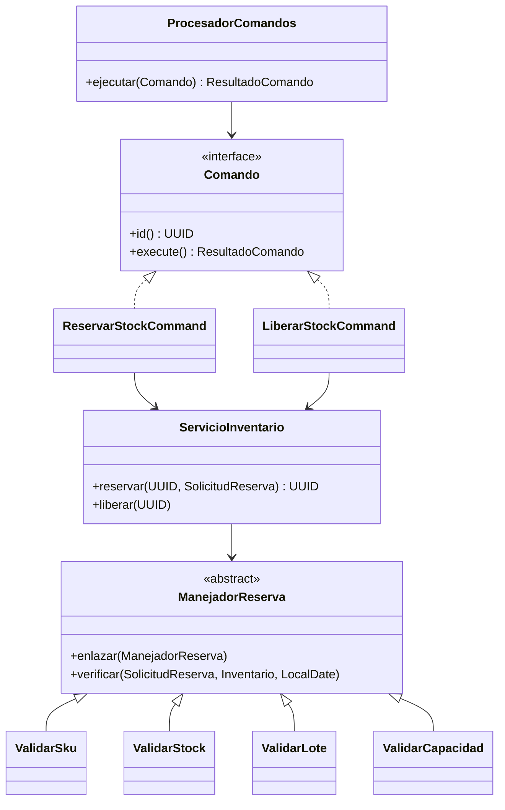
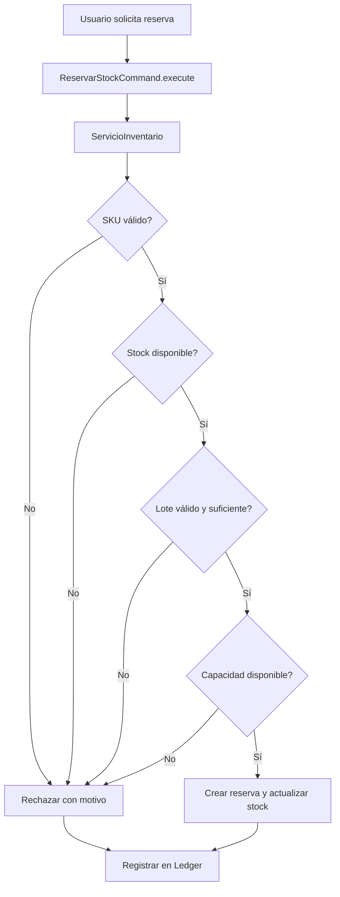

# LOGISTPULSE · Smart Inventory (Java)

Prototipo académico de **reserva de inventario inteligente**, construido en Java 17 y con **dos patrones de comportamiento**: **Command** y **Chain of Responsibility**. Basado en la presentación *Patrones de comportamiento en el Smart Inventory de LOGISTPULSE*.

> **Alcance:** aplicación de consola con datos en memoria. **No** incluye API REST, interfaz web, PostgreSQL, Docker, autenticación real ni persistencia al reiniciar. Es un proyecto Java independiente de cualquier repositorio LOGISTPULSE anterior.

## ¿Qué hace?

- Consultar inventario por SKU y lote.
- Reservar stock y liberar reservas mediante objetos `Comando`.
- Validar en orden: **SKU → stock global reservable → lote → capacidad de preparación**.
- Evitar reservar lotes **vencidos** o en **cuarentena**.
- Llevar un **ledger** (historial) de operaciones aceptadas y rechazadas.
- Evitar duplicados si se reenvía el mismo ID de comando (**idempotencia**, durante la ejecución actual).
- Compensar una reserva con un comando independiente de liberación.

## Requisitos

- **JDK 17 o posterior** (no basta con un JRE).
- **Visual Studio Code** y extensión **Extension Pack for Java** (recomendado).
- **Git** para publicar en GitHub.
- **Apache Maven** (opcional para consola, necesario para `mvn test` con JUnit).

## Ejecutar en Visual Studio Code (opción fácil)

1. Abre en VS Code la **carpeta raíz** de este proyecto (donde está `pom.xml`).
2. Instala **Extension Pack for Java** si aún no lo tienes.
3. Abre `src/main/java/ec/edu/logistpulse/App.java`.
4. Pulsa **Run** arriba de `main(...)` y usa la **Terminal** para escribir opciones. Si el depurador no acepta entrada, abre la terminal integrada y ejecuta `./scripts/ejecutar.ps1` desde PowerShell.

### Ejecutar en PowerShell sin Maven

```powershell
java -version
javac -version
.\scripts\ejecutar.ps1
```

Si PowerShell bloquea `.ps1`, puedes usar Maven o los comandos Java directos de `docs/GITHUB_PASO_A_PASO.md`. No cambies la política de ejecución del sistema solo para ejecutar el proyecto.

### Pruebas sin Maven

```powershell
.\scripts\verificar.ps1
```

### Pruebas con Maven (12 casos JUnit)

```powershell
mvn test
```

La primera vez Maven puede necesitar internet para descargar sus plugins y las dependencias de pruebas.

## Demostración sugerida

1. Opción `1`: examinar lotes `L-100`, `L-200`, `L-201` (cuarentena) y `L-202` (vencido).
2. Opción `2`: SKU `MED-002`, lote `L-200`, cantidad `3`, solicitante `docente` → **aprobado**.
3. Opción `2`: mismo SKU, lote `L-201`, cantidad `1` → **rechazado por cuarentena**.
4. Opción `2`: mismo SKU, lote `L-202`, cantidad `1` → **rechazado por vencimiento**.
5. Opción `2`: SKU `MED-001`, lote `L-100`, cantidad `6` → **rechazado por capacidad** (quedan 5 espacios).
6. Opción `4`: copiar el UUID de la reserva aprobada.
7. Opción `3`: pegar el UUID de la reserva y liberar; la cantidad vuelve al lote y se desocupa la zona de preparación.
8. Opción `5`: mostrar el ledger de auditoría de todas las decisiones.

## Dónde está cada patrón

| Patrón | Clases | Responsabilidad |
|---|---|---|
| Command | `Comando`, `ReservarStockCommand`, `LiberarStockCommand`, `ProcesadorComandos` | Convertir acciones en objetos, ejecutarlas, aplicar idempotencia y generar auditoría. |
| Chain of Responsibility | `ManejadorReserva`, `ValidarSku`, `ValidarStock`, `ValidarLote`, `ValidarCapacidad` | Ejecutar comprobaciones independientes y detener la reserva con un motivo claro. |
| Modelo de dominio | `Producto`, `Lote`, `Reserva`, `Almacen`, `Inventario` | Representar el inventario, las reservas y la capacidad. |
| Receptor | `ServicioInventario` | Conectar los patrones y actualizar el inventario. |

## Diagrama de clases simplificado



## Flujo de una reserva



## Archivos para entregar

- `src/main/java`: código completo.
- `src/test/java`: pruebas unitarias JUnit.
- `docs/DISENO_DEL_SISTEMA.md`: justificación técnica, reglas y limitaciones.
- `docs/GITHUB_PASO_A_PASO.md`: publicación desde VS Code en Windows.
- `.github/workflows/ci.yml`: ejecuta pruebas automáticamente en GitHub Actions.

## Extensiones futuras (NO implementadas)

- Automatizar selección FEFO/FIFO/LIFO con **Strategy**.
- Persistir productos, reservas y ledger en PostgreSQL con transacciones y restricciones SQL.
- Exponer `POST /reservations` con Spring Boot.
- Integrar `StockChanged`, reposición y PULSEFLEET mediante **Observer**.

Esta primera versión **implementa exactamente dos patrones**, evitando simular que incluye otros patrones aún no programados.
