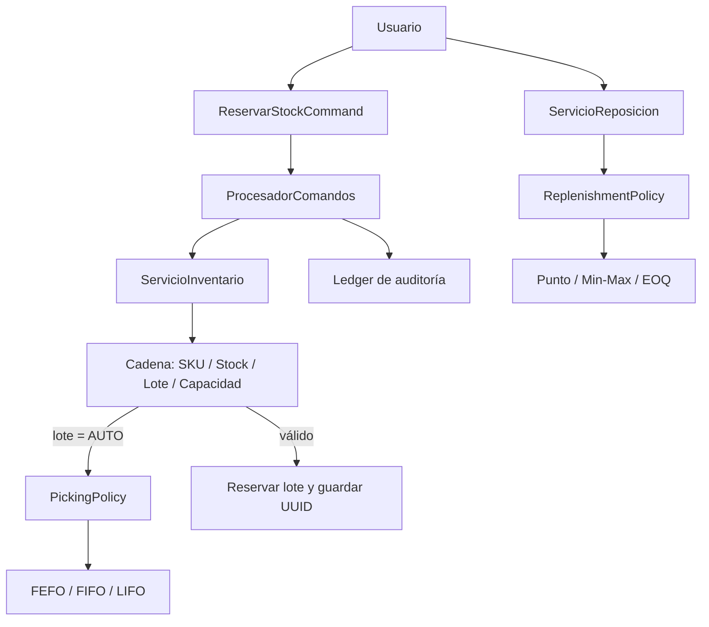

# LOGISTPULSE · Smart Inventory — Java (Command + Chain + Strategy)

> **Versión 2.0 · Proyecto académico funcional por consola**. Ampliación del repositorio original `logistpulse-smart-inventory-java`. Basado en las diapositivas de LOGISTPULSE: **Command**, **Chain of Responsibility** y **Strategy**.

LOGISTPULSE permite consultar inventario, reservar y liberar unidades, mantener historial de operaciones y **seleccionar automáticamente un lote** con una estrategia intercambiable. También ofrece **recomendaciones de reposición** con tres algoritmos distintos. Todos los datos son ficticios y permanecen **en memoria** mientras el programa está abierto.

## Funcionalidades

- **Command:** `ReservarStockCommand`, `LiberarStockCommand`, `ProcesadorComandos` (auditoría e idempotencia por ID del comando).
- **Chain of Responsibility:** `ValidarSku` → `ValidarStock` → `ValidarLote` → `ValidarCapacidad`.
- **Strategy de picking:** `FEFO` (primero en vencer), `FIFO` (primero en llegar) y `LIFO` (último en llegar). Cambia la política en ejecución, general o por SKU.
- **Strategy de reposición:** `Punto de reorden`, `Min-Max` y `EOQ`. Cambia la política en ejecución, general o por SKU. Son **recomendaciones**, no compras reales.
- `AUTO` en el campo lote usa Strategy; un ID explícito como `L-200` realiza una reserva manual.
- Nunca selecciona en modo `AUTO` un lote **vencido**, **en cuarentena** o con unidades insuficientes.
- Cada reserva ocupa un solo lote (no hay reparto parcial entre varios lotes). Se registra el lote realmente asignado.

## Ejecutar directamente en GitHub Codespaces

1. Abre tu repositorio en GitHub y accede a **Code → Codespaces → Open in browser**.
2. Sube el ZIP de actualización y extráelo **en la raíz del repositorio** (junto a `pom.xml`); consulta [docs/ACTUALIZAR_CODESPACES.md](docs/ACTUALIZAR_CODESPACES.md).
3. En la terminal de Codespaces ejecuta:

```bash
mvn test
mvn -q -DskipTests package
java -cp target/classes ec.edu.logistpulse.App
```

La aplicación requiere **JDK 17 o superior** y Maven en el entorno de Codespaces. **No es necesario instalarlos en Windows.** Para un entorno sin Maven, compila con `javac` como describe la guía.

## Menú del sistema

| Opción | Acción |
|---|---|
| `1` | Consultar productos y lotes (incluye fecha de recepción y de vencimiento) |
| `2` | Reservar stock: SKU, lote (`AUTO` o ID), cantidad y solicitante |
| `3` | Liberar una reserva por UUID |
| `4` | Consultar reservas y lote asignado |
| `5` | Consultar ledger de auditoría |
| `6` | Cambiar selección de lotes: FEFO / FIFO / LIFO (general o por SKU) |
| `7` | Cambiar reposición: punto de reorden / Min-Max / EOQ (general o por SKU) |
| `8` | Calcular recomendación de reposición |
| `0` | Salir |

## Demostrar FEFO, FIFO y LIFO

Con el SKU `MED-002`, escribe **`AUTO`** en el campo lote y solicita **una unidad** con la capacidad de preparación libre. Cada política asigna un lote distinto:

| Política activa | Lote asignado | Criterio |
|---|---|---|
| **FEFO** (inicial) | `L-200` | Vence antes: 2027-02-15 |
| **FIFO** (opción 6 → 2) | `L-203` | Recibido antes: 2026-08-01 |
| **LIFO** (opción 6 → 3) | `L-204` | Recibido después: 2026-11-01 |

> Para una demostración limpia de cada estrategia, reinicia la aplicación antes de hacer una nueva reserva, o libera reservas anteriores, para no agotar lotes ni capacidad. Selecciona `TODOS` cuando se solicite el alcance de la política.

Para mostrar reposición, selecciona **opción 8** y SKU `TEC-001` (stock inicial 3). Las recomendaciones de ejemplo son:

| Política | Unidades recomendadas |
|---|---:|
| Punto de reorden | 5 |
| Min-Max | 12 |
| EOQ | 12 |

## Arquitectura



Los algoritmos están en `src/main/java/ec/edu/logistpulse/estrategia/{picking,reposicion}/`. Las interfaces `PickingPolicy` y `ReplenishmentPolicy` son los contratos Strategy; `ServicioInventario` y `ServicioReposicion` son los **contextos** que escogen la implementación. Para detalles de clases, reglas y limitaciones lee [docs/DISENO_DEL_SISTEMA.md](docs/DISENO_DEL_SISTEMA.md).

## Verificación

```bash
mvn test                # Ejecuta 34 casos JUnit (12 existentes + 22 nuevos)
mvn -q -DskipTests package
java -cp target/classes ec.edu.logistpulse.App
```

También hay 12 verificaciones rápidas ejecutables sin JUnit en `src/smoke/java/` (6 originales y 6 de Strategy).

GitHub Actions ejecuta `mvn -B test` en cada push mediante `.github/workflows/ci.yml`.

## Alcance y limitaciones

- Prototipo **Java de consola**, sin web, REST ni base de datos.
- Los productos, reservas, el ledger y los cambios de estrategia se **pierden al reiniciar**.
- Las reservas `AUTO` se hacen desde **un solo lote**, nunca mezclando lotes.
- La **reposición** muestra una estimación: no registra órdenes de compra ni pronostica demanda a partir de datos reales.
- No hay autenticación ni protección de concurrencia/atomicidad apta para una implementación productiva.

### Documentación

- [Diseño de sistema, patrones, UML y justificación](docs/DISENO_DEL_SISTEMA.md)
- [Actualizar tu repositorio desde Codespaces](docs/ACTUALIZAR_CODESPACES.md)
- [Guía anterior de VS Code y GitHub](docs/GITHUB_PASO_A_PASO.md)
