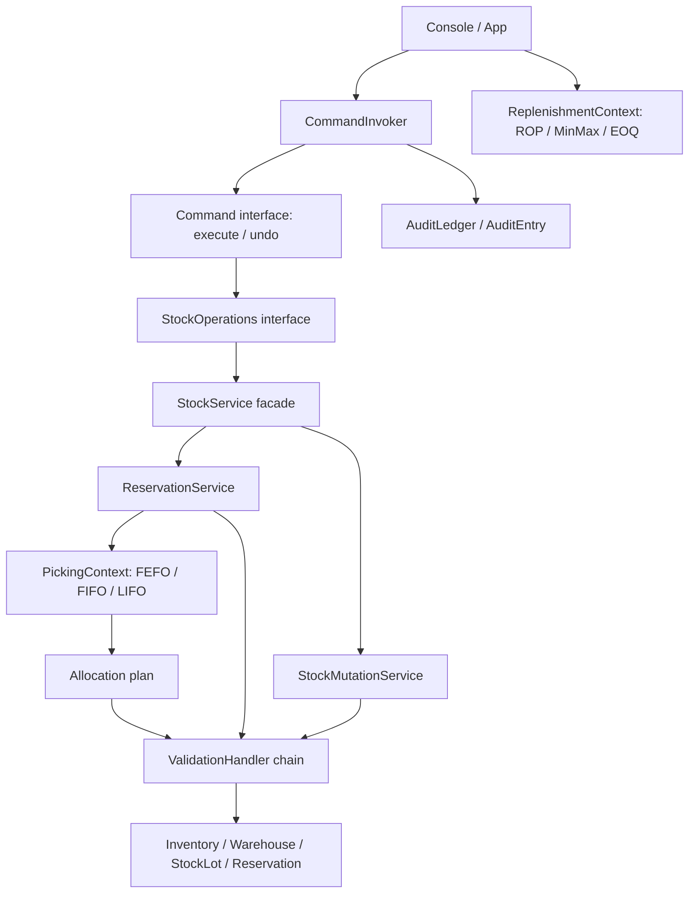
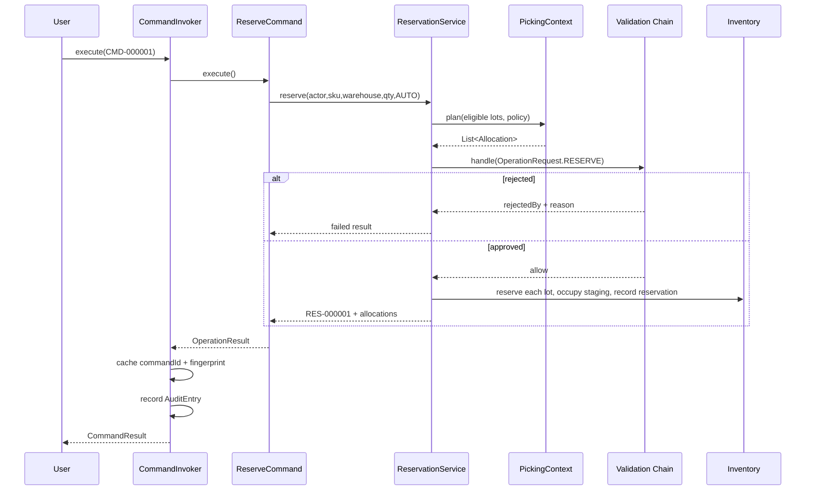

# Diseño del sistema: LOGISTPULSE Smart Inventory v3.0

## Problema

Asegurar reservas auditables con selección configurable de lotes, sin violar stock,
cuarentena, expiración, capacidad, ownership ni permisos de operación.

## Arquitectura y responsabilidades

Las dependencias se construyen en `SampleData`; no existen `new FefoPickingPolicy()` ni
`new IdentityHandler()` dentro de `StockService`.

## Diagrama de secuencia: Reserve

## Chain for all four operations

| Handler | RESERVE | RELEASE | ADJUST | TRANSFER |
|---|---|---|---|---|
| Identity | registered actor | registered actor | registered actor | registered actor |
| Resource | SKU/warehouse | active reservation | source lot | source lot/target warehouse |
| Authorization | operator/supervisor | owner or supervisor | supervisor | supervisor |
| Stock | aggregate/plan quantity | — | onHand ≥ reserved | available source stock |
| Lot | expiry/quarantine/SKU/warehouse | — | — | valid lot/different destination |
| Capacity | staging | — | storage when increasing | destination storage |

Each handler either calls the next through the shared `handle` implementation or
returns a `ValidationResult` with its `rejectedBy` stage and reason.

## SOLID (evidence)

- **S**: `PickingContext` selects; `ValidationHandler` validates; `ReservationService`
  updates reservation state; `StockMutationService` adjusts/transfers; `AuditLedger` audits.
- **O**: add a strategy by implementing `PickingPolicy`/`ReplenishmentPolicy`; add a
  handler in `SampleData` without editing `StockService`. New operation types
  would still require adapting relevant validators (known tradeoff).
- **L**: all `PickingPolicy` implementations produce orderings; business rejection is
  reported by `ValidationResult` rather than depending on undocumented policy exceptions.
- **I**: small contracts: `PickingPolicy`, `ReplenishmentPolicy`, `StockOperations`,
  `ActorDirectory`, `AuditLedger`.
- **D**: Commands know the `StockOperations` interface; service dependencies and handlers
  are injected at composition root rather than instantiated in receiver constructors.

## Idempotency and undo

`CMD-000001` + fingerprint identifies **a particular request**. Repeating that same
request returns the original result without repeating the inventory mutation; reusing
that ID with different actor/parameters is rejected and audited. Once compensated,
executing again with the old ID does **not** create a new reservation.

`undo()` attempts **compensating** operations, not an unconditional rollback:
Reserve ↔ Release, Adjust(+q) ↔ Adjust(−q), Transfer ↔ return to origin, Release ↔ Restore.
Each compensation is subject to current validity, available stock and roles.

## Domain invariants

- `0 ≤ reserved ≤ onHand` per lot.
- `0 ≤ staged ≤ stagingCapacity` per warehouse.
- `warehouseOnHand ≤ storageCapacity` after adjustments/transfers.
- no expired/quarantined lot may be selected for a new reservation.
- allocated quantities must exactly equal the requested quantity.
- reservation ownership must be checked on release.
- transferred quantity must be available and the destination distinct.

## Why this is still a prototype

Single-process state, no transaction DB, memory-only ledger and sequence, demo actors
without cryptographic identity, one-process synchronization and no resilient storage.
A production migration would use durable storage, unique command keys, ACID transactions,
formal authorization, audit retention and concurrent reservation conflict handling.
