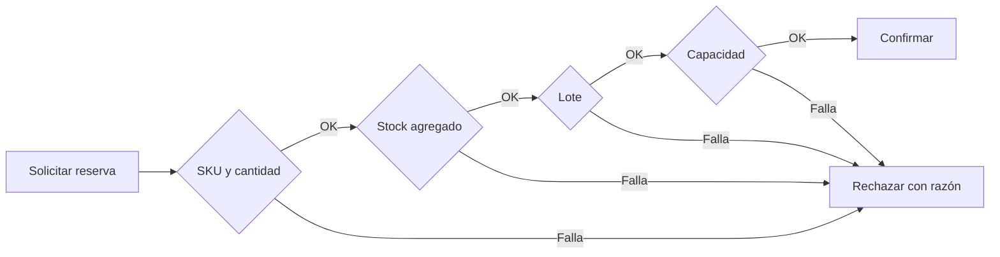
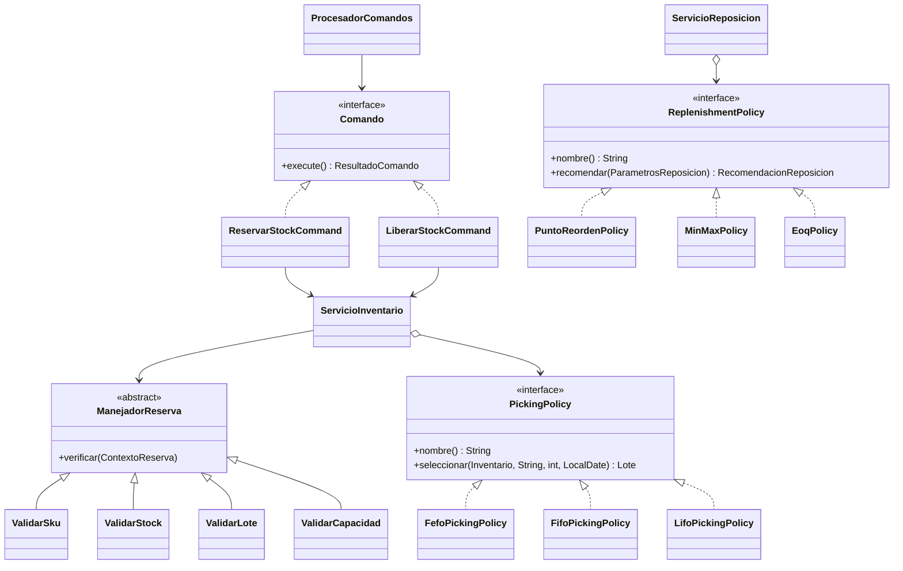

# Diseño de sistemas — LOGISTPULSE Smart Inventory 2.0

## 1. Problema y objetivo

Una empresa necesita reservar productos sin descontar existencias inválidas, justificar los rechazos y elegir qué lote despachar según la política operativa. También necesita simular cuándo reponer existencias, pudiendo cambiar el algoritmo por producto. LOGISTPULSE es un prototipo académico en **Java 17**, con datos ficticios almacenados en memoria.

**Base:** presentación del usuario *Patrones de comportamiento en el Smart Inventory de LOGISTPULSE*. Las páginas 2, 3 y 4 describen **Command**, **Chain of Responsibility** y **Strategy**, respectivamente. La diapositiva de Strategy propone tanto picking **FEFO/FIFO/LIFO** como reposición **punto de reorden/EOQ/Min-Max**.

## 2. Arquitectura y responsabilidades

| Capa | Clases principales | Responsabilidad |
|---|---|---|
| Interfaz | `App` | Menú, lectura de solicitudes, cambio de políticas, salida al usuario |
| Command | `Comando`, `ReservarStockCommand`, `LiberarStockCommand`, `ProcesadorComandos` | Encapsular, ejecutar, deduplicar y auditar operaciones |
| Chain | `ManejadorReserva`, `ValidarSku`, `ValidarStock`, `ValidarLote`, `ValidarCapacidad` | Validar por pasos, detener la operación cuando se incumple una condición |
| Strategy — picking | `PickingPolicy`, `FefoPickingPolicy`, `FifoPickingPolicy`, `LifoPickingPolicy` | Decidir qué lote válido usar cuando se solicita `AUTO` |
| Contexto de picking | `ServicioInventario`, `ContextoReserva` | Seleccionar la política general o configurada para un SKU y coordinar reserva |
| Strategy — reposición | `ReplenishmentPolicy`, `PuntoReordenPolicy`, `MinMaxPolicy`, `EoqPolicy` | Devolver cantidad sugerida de abastecimiento |
| Contexto de reposición | `ServicioReposicion` | Mantener/cambiar la política general o por SKU |
| Dominio y auditoría | `Producto`, `Lote`, `Reserva`, `Inventario`, `Almacen`, `LibroAuditoria` | Estado de negocio y ledger en memoria |

## 3. Patrón Command

**Problema:** el menú no debe decidir cómo modificar inventario o liberar stock, y los reintentos no deben descontar existencias dos veces.

**Solución:** la interfaz `Comando` encapsula una operación; `ProcesadorComandos` la ejecuta, guarda el resultado según UUID y registra aceptación o rechazo. `ReservarStockCommand` y `LiberarStockCommand` delegan en `ServicioInventario`.

Un mismo UUID con el mismo contenido devuelve el resultado anterior (**idempotencia en memoria**); la reutilización del UUID con otro contenido se rechaza. Liberar compensa **una reserva activa**, no deshace arbitrariamente cualquier comando anterior.

## 4. Patrón Chain of Responsibility

1. `ValidarSku`: existencia del producto, cantidad positiva, actor no vacío.
2. `ValidarStock`: stock reservable agregado entre lotes habilitados del SKU.
3. `ValidarLote`: si el ID es `AUTO`, consulta **Strategy** para resolver el lote; si es explícito, verifica ese lote. En ambos casos exige pertenencia correcta, no vencido, no en cuarentena y unidades suficientes.
4. `ValidarCapacidad`: verifica espacio libre en la zona de **preparación**.

Si una validación falla, se lanza `ValidacionException` con motivo y la reserva no modifica el inventario.

## 5. Patrón Strategy — política de picking

**Problema:** una sola función de selección con numerosos `if/else` se vuelve compleja cuando una empresa cambia entre prioridades por vencimiento o fecha de llegada.

**Solución:** `PickingPolicy` define el contrato `seleccionar(Inventario, sku, cantidad, hoy)`; tres implementaciones cambian solamente el **orden de selección**, pero comparten los mismos filtros obligatorios en `SeleccionLotes`:

- **FEFO:** menor `fechaVencimiento` primero, desempata por fecha de recepción e ID.
- **FIFO:** menor `fechaRecepcion` primero, desempata por vencimiento e ID.
- **LIFO:** mayor `fechaRecepcion` primero, desempata por vencimiento e ID.

**Contexto:** `ServicioInventario` guarda una política general (FEFO al iniciar) y un mapa `SKU → PickingPolicy` que permite anular la predeterminada para un producto. El manejador `ValidarLote` usa la estrategia solamente cuando `loteId` es `AUTO`; si el usuario especifica `L-200`, se respeta la elección manual siempre que pase las validaciones.

**Regla de negocio elegida:** una reserva se asigna a **un solo lote con suficientes unidades**. Si el inventario total tiene existencias suficientes pero están dispersas entre lotes pequeños, `AUTO` puede rechazar la reserva. No implementamos división en múltiples lotes.

## 6. Patrón Strategy — política de reposición

**Contrato:** `ReplenishmentPolicy.recomendar(ParametrosReposicion)` devuelve `RecomendacionReposicion` con política, umbral, cantidad sugerida y explicación. El **contexto** `ServicioReposicion` permite cambiar la política general o por SKU sin cambiar el método `recomendar`.

### Algoritmos utilizados

- **Punto de reorden:** `ROP = demandaDiaria × plazoEntrega + stockSeguridad`. Si `stockActual ≤ ROP`, se sugiere una cantidad igual a la demanda del plazo de entrega. Simplificación académica; no crea orden de compra.
- **Min-Max:** si `stockActual ≤ ROP` (se usa ROP como mínimo), sugerir `stockMaximo − stockActual`; en otro caso, sugerir 0.
- **EOQ:** `Q* = sqrt((2 × demandaAnual × costoPorPedido) / costoMantenimientoAnualUnidad)`. Si `stockActual ≤ ROP`, sugerir `ceil(Q*)`; en otro caso 0.

Los cálculos son **simulaciones** basadas en parámetros precargados; no son pronósticos reales ni alteran la cantidad disponible.

### Demostración con SKU TEC-001

Parámetros de prueba: 3 unidades, demanda diaria 1, plazo de entrega 5 días, stock de seguridad 2, máximo 15, demanda anual 365, costo por pedido 2, costo anual de tenencia 12. Por tanto `ROP = 1 × 5 + 2 = 7`:

| Algoritmo | Cálculo | Sugerido |
|---|---|---:|
| Punto de reorden | `1 × 5` | 5 |
| Min-Max | `15 − 3` | 12 |
| EOQ | `ceil(sqrt(2 × 365 × 2 / 12))` | 12 |

## 7. Diagrama UML simplificado

## 8. Datos de demostración

| SKU | Lote | Disponible inicial | Recepción | Vencimiento | Estado |
|---|---|---:|---|---|---|
| MED-001 | L-100 | 10 | 2026-08-15 | 2099-12-31 | Habilitado |
| MED-002 | L-200 | 6 | 2026-09-10 | 2027-02-15 | Habilitado |
| MED-002 | L-203 | 8 | 2026-08-01 | 2028-12-31 | Habilitado |
| MED-002 | L-204 | 7 | 2026-11-01 | 2029-06-30 | Habilitado |
| MED-002 | L-201 | 5 | 2026-07-01 | 2099-12-31 | Cuarentena |
| MED-002 | L-202 | 4 | 2019-08-01 | 2020-01-01 | Vencido |
| TEC-001 | L-300 | 3 | 2026-10-01 | 2099-12-31 | Habilitado |

**Capacidad de preparación: 8 unidades.** Con SKU `MED-002` y lote `AUTO`, para una cantidad de 1: FEFO elige `L-200`, FIFO `L-203`, LIFO `L-204`.

## 9. Reglas, pruebas y limitaciones

- `disponible` y `reservado` nunca pueden ser negativos; ocupación en preparación entre 0 y capacidad.
- En este ejemplo, un lote se considera vencido cuando su fecha de vencimiento **es anterior** al día actual (en la fecha exacta, aún se acepta).
- El estado se conserva solo mientras el proceso está en ejecución; al reiniciar se reinicia también la política escogida.
- El sistema no es un servicio multiusuario concurrente transaccional. En producción se necesitarían controles de BD y bloqueo o concurrencia optimista.
- El actor no está autenticado; el ledger no es persistente ni regulatorio.
- `mvn test` ejecuta **34 pruebas JUnit** (12 existentes + 22 añadidas); en `src/smoke/java` hay 12 verificaciones ejecutables manualmente sin JUnit.

## 10. Cómo defender la integración

> **Command** organiza las operaciones en solicitudes ejecutables y auditables; **Chain of Responsibility** verifica cada requisito de la reserva y puede detenerla con una causa precisa; **Strategy** permite sustituir el algoritmo de selección de lote o reposición sin cambiar ni los comandos ni la estructura de las validaciones. Un mismo `ReservarStockCommand` con lote `AUTO` puede asignar distintos lotes según la política activa, conservando las mismas reglas de seguridad.
